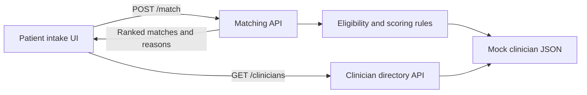

# LunaJoy clinician matching demo — architecture

## Overview

The demo is a small, serverless web application designed for Vercel. A React interface bundled by Vite collects patient preferences and submits them to a Node.js API function. The function applies explicit eligibility rules and a weighted ranking model to a local JSON clinician catalogue, then returns ranked profile cards with match explanations.

## Components and data flow

1. `index.html`, `src/app.js`, and `src/styles.css` provide the responsive React intake and results experience; Vite bundles React locally into `dist/`.
2. `api/clinicians.js` serves a safe subset of mock clinician records through `GET /clinicians`.
3. `api/match.js` validates the request and returns eligible, ranked clinicians through `POST /match`.
4. `api/match-explain.js` returns a plain-language summary for the highest ranked result through `POST /match/explain`.
5. `lib/matching.js` contains shared eligibility and scoring rules; `data/clinicians.json` is the mock catalogue.
6. `vercel.json` maps the required `/clinicians`, `/match`, and `/match/explain` paths to serverless functions.

## Stack

- React 18 and Vite client bundle, served as static assets.
- Vercel Node.js serverless functions (CommonJS).
- JSON mock data; no database or external scheduling dependency.
- Vercel Git integration for preview and production deployments.

## Production considerations

This is a demonstration using fictional provider records. A production system should source licensure, credentialing, insurance, and appointment inventory from authoritative systems; apply authentication and access controls; minimize and protect health information; instrument auditable decision events; and monitor ranking outcomes for access and fairness. No patient data is persisted by this demo.
